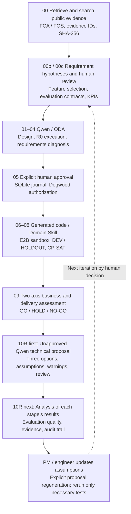

# Claims Operations Planner — AI Venture Feasibility Studio v0.33.0

**A human-in-the-loop proof of concept for evaluating technical feasibility, connecting customer-problem hypotheses to generative-AI prototypes, independent evaluation, and technical proposals.**

The application uses a **fictional German insurance-software SaaS company** as its prospective customer, with claims-status notifications and claims-handler assignment as example problems. Public documents establish background context; they do not establish the fictional customer's approved requirements, the causes of its delays, or its return on investment. The goal is **not to deploy LLM outputs directly to production**, but to **separate successful execution, requirements compliance, independent quality evaluation, and business adoption decisions, so that humans can choose the next validation step**.

## 1. Architecture and Design Principles (v0.33)



The screen order is **10 (full workflow) → 10R (AI proposal → individual stage evaluations) → 00 → 01–09**. Steps 00–09 in the diagram are shown in their logical execution order. The public-evidence review at 00b and R1 approval at 05 require explicit human actions. A workflow may have the execution status `COMPLETE` while its quality assessment remains `HOLD` and its production decision remains `NO_GO`.

### 1.1 Implemented Technologies and Responsibilities

| Layer | Implemented technologies | Responsibility and scope of assurance |
| --- | --- | --- |
| Web / API | React 19, TypeScript, Vite 7 / FastAPI, Uvicorn | Full workflow execution, human-in-the-loop review, report display, workflow orchestration |
| Local inference | Ollama, Qwen3-Coder 30B, ODA-Fin-RL-8B | Qwen: design, Python code, technical proposals. ODA: diagnosis of financial-domain requirements. **Neither is an independent ground-truth oracle.** |
| Evidence-grounded RAG | Python, HTTPX, BM25-like scores, character trigrams, RRF | Tracks source documents, source-text locations, `PUB-*` IDs, and SHA-256 hashes for FCA/FOS and other material. Search ranking does not prove causality or requirements. |
| Output contracts | Pydantic v2, JSON Schema | Checks structure, cross-field consistency, and requirements traceability. Schema compliance does not guarantee semantic correctness. |
| Candidate algorithms | Qwen-generated code, fixed Domain Skills, Deadline / Scarcity, Bounded Beam | Claims-handler assignment under deadlines, qualifications, and daily capacity. Beam search is not an exact optimizer. |
| Isolated execution | E2B Sandbox | Isolates generated code and Skills; preserves execution IDs, results, and hashes. Business correctness is evaluated separately. |
| Temporal authorization | Rust Dogwood Local Engine, SQLite approval/revocation journal, hash chain | Checks approval precedence, validity periods, ID consistency, and revocation. Denies requests when authorization cannot be determined. Real-world user identity verification is separate. |
| Independent evaluation | Fixed rubrics, behavioral probes, synthetic DEV / HOLDOUT, six diagnostic dimensions | Distinguishes code execution, requirement alignment, raw diagnostic performance, and results on previously unseen synthetic cases. |
| Optimality comparison | Optional OR-Tools CP-SAT / small-instance exhaustive search | Compares candidate solutions under the lexicographic objective of missed deadlines followed by unassigned cases. Claims optimality only when `OPTIMAL` is confirmed. |
| Audit and decisions | JSON / Markdown / ZIP, SHA-256, Business & Delivery Assessment | Traces sources, approvals, models, executions, selections, and evaluations; records reasons for `HOLD` and `NO_GO`. |
| Advisory improvement loop | 10R Advisory, Qwen, editable assumptions, snapshot matching | Produces three unapproved options: low-complexity, balanced, and R&D. Drafts with warnings can be reviewed but never become execution permissions. |

### 1.2 Do Not Conflate Functional Requirements with Technical Experiments

- **Claims-status notifications (`claim_progress_updates`)**: Synthetic acceptance tests check notification timing, recipients, omissions, and failure behavior. Improvements in assignment algorithms cannot substitute for acceptance of the notification feature.
- **Claims-handler assignment (R0 / R1)**: Starting from FIFO, the application compares Skills and LLM-generated code that account for deadlines, scarce qualifications, and capacity constraints. The **causal relationship remains unverified** between improved assignment and reduced notification delays.
- **Evaluation and authorization are different contracts**: Dogwood permission does not establish model quality. A CP-SAT optimum for a synthetic assignment problem does not establish actual customer requirements or production suitability.

## 2. Technical Proposals and Iterative Improvement in 10R (Core v0.33 Feature)

At the **top** of 10R, Qwen generates an **unapproved technical proposal** using saved evaluations from steps 00–09. Results from each stage appear below it. The proposal does not autonomously rerun LLM evaluation or grant permissions; it provides material for PMs and engineers to consider.

| Sample input | Demo default | Interpretation |
| --- | ---: | --- |
| Budget | €30,000 | `DEMO_PLACEHOLDER_UNVERIFIED` (not a customer-approved budget) |
| Developers | 2 people | Unverified assumption; editable or clearable |
| PM allocation | 0.2 FTE | Unverified assumption |
| Development period | 8 weeks | Unverified assumption |
| Implementation/operations priorities | Prefer existing APIs; no dedicated operations staff | Unverified assumption |

The proposal contains **A: low-complexity option / B: balanced PoC / C: R&D option**. Approximate cost estimates may be presented as uncertain hypotheses and are distinguished from the customer's budget. Public-evidence IDs and source locations are retrieved deterministically from persisted records. The LLM may freely propose causal hypotheses about customer problems, but these are explicitly marked **unverified**.

- **Expose semantic inconsistencies**: If the structured output is valid, a disagreement between a proposal's text and its self-reported requirement coverage does not cause the draft to be discarded. Instead, it is stored and displayed as `DRAFT_WITH_WARNINGS`. Targeted repair of problematic technical options is attempted, but an unsuccessful repair does not erase the entire proposal.
- **Fail-closed execution authorization**: The ability to read an unapproved draft does not imply Dogwood execution permission or a production GO decision at step 09. If the structured response cannot be obtained at all, the UI indicates that no proposal was retrieved and keeps the existing evaluation report visible.
- **Track evaluation state**: The hash of the evaluation snapshot used to generate the proposal is stored. Older proposals whose underlying evaluation changes after a retry are identified as `STALE_ADVISORY`. Generation from the latest `COMPLETE` status is the normal path; `PARTIAL` requires an explicitly selected provisional mode.
- **Human improvement loop**: A person edits the assumptions, concerns, and next-run brief → regenerates only the proposal → examines differences and version history → explicitly reruns only the necessary evaluations. **Autonomous CI/CD, production deployment, and unattended approval are not implemented.**

## 3. Example Run Results (Synthetic v0.33 Run on 2026-11-22)

| Evaluation target | Observed result | Interpretation |
| --- | --- | --- |
| Workflow | 18 / 18 steps `COMPLETE` | Execution completed; neither quality nor commercial suitability was approved |
| Dogwood negative paths | 8 / 8 PASS | The limited authorization counterexamples passed in this run |
| Synthetic notification acceptance | 4 / 4 PASS | Real-customer integration and end-to-end integration with assignment remain untested |
| Discriminating DEV cases | 0 / 11 | Preselection data failed to distinguish the candidates |
| 08f: selected R1 / Bounded Beam | Agreement with CP-SAT optimum: 1 / 4 versus 4 / 4 | Difference observed on **four separate, post-selection synthetic cases**; not a generalization guarantee |
| Qwen / ODA diagnostic Fresh Blind RAW | Both 0 / 2 | Do not confuse repair or partial improvements with success on independent blind cases |
| 10R technical proposal | `DRAFT_WITH_WARNINGS` | Three options were generated, but contradictions remained between proposal text and self-assessed requirement coverage |
| Diagnostic / business decision | `HOLD` / `NO_GO` | Production adoption remains unapproved due to quality issues and incomplete notification integration, among other concerns |

Evidence bundle: `claims_full_run_v033_f69162f1-1507-48fc-9514-e39f56716656.zip`. These values are observations from this specific synthetic run; they do not establish universal model rankings, customer ROI, TCO savings, or regulatory compliance.

## 4. Implementation Scope and Explicit Limitations

**Implemented:** Lexical-retrieval RAG, structured LLM output, E2B isolated execution, local Dogwood temporal authorization, Domain Skills and beam search, independent DEV/HOLDOUT evaluation, optional CP-SAT, diagnostic benchmarks, two-axis business assessment, and unapproved proposals, reviews, and version management in 10R.

**Not implemented:** GraphRAG / GNN-RAG, formal proofs with Lean 4 / SMT, Neural Operators, World Models / JEPA, VLA / Flow Matching, autonomous CI/CD or production deployment, or automatic guarantees concerning actual customer SLAs, contracts, and regulatory compliance.

This PoC is a single-user local demo. Authentication, rate limiting, production-grade secret management, verified identity, and customer-specific regulatory review would have to be implemented separately. See the detailed sections below for runtime setup, operations, APIs, and audit artifacts.

## 5. Change Log (v0.33.0 → v0.10, Newest First)

> **v0.33.0 — Demo assumptions, provisional proposals, and drafts with warnings:** The initial 10R values—€30,000 budget, two developers, 0.2 PM FTE, eight weeks, preference for existing systems, and no dedicated operations staff—are **fictional, unverified assumptions**, prefilled in the UI and applied by the API. They can be entered, updated, or cleared. Customer budgets are distinct from LLM-generated cost estimates; numerical estimates alone do not invalidate a proposal. If an LLM response is structurally valid, remaining inconsistencies are displayed and saved per option under `DRAFT_WITH_WARNINGS`, and a PM can review and regenerate the draft. Dogwood authorization and production adoption remain fail-closed. Even when no structured response is obtained, the demo assumptions and the existing 00–09 evaluation report remain visible. See `docs/v033-demo-assumptions-and-reviewable-drafts.md`.

> **v0.32.0 — 10P responsibility boundaries and COMPLETE synchronization (only the three high-priority items):**
> 1. PUB IDs, URLs, and source locations from public evidence selected by a human are recorded deterministically and displayed separately from model-generated customer-problem hypotheses, which always remain unverified. Public sources do not prove the fictional customer's root cause.
> 2. When an initially typed proposal fails certain **semantic contracts**, only the violating top-level sections are regenerated, at most once, while unchanged sections are preserved. A failed revalidation results in `GENERATION_FAILED` (FAIL-CLOSED). Repair does not imply automatic approval, and complete preservation of raw model responses or generic recovery from structural errors is outside the scope of this version.
> 3. Automatic 10P generation starts only from the latest `COMPLETE` state. Generation from `PARTIAL` requires an explicit provisional mode in the UI and `provisional_mode=true` in the API. If a retry at step 08 changes the evaluation, the proposal becomes `STALE_ADVISORY` and must be regenerated before human review. **Steps 00–09, Dogwood, DEV/HOLDOUT, and CI/CD integration were unchanged.** See `docs/v032-priority-high-advisory-boundaries.md`.

> **v0.31.0 — Technical proposals aligned with the latest evaluation:** The AI draft at the beginning of 10R references SHA-256 hashes of the latest step 08 diagnostics (including retries), step 09 business decision, public evidence, and acceptance contracts for the notification requirement. If a subsequent evaluation update no longer matches the draft, 10R displays `STALE_ADVISORY`, **rejects PM review, and accepts only explicit regeneration**. Earlier versions remain in the audit history. `claim_progress_updates` and claims-handler assignment are treated as distinct features; evidence IDs, requirement IDs, and three technical options are checked for consistency. In Japanese, each option describes necessary roles, relative effort, risks, cost drivers, and trade-offs, and the next experiment specifies an owner and success metrics. Changes from the previous version are displayed. Missing budget or staffing values are labeled unconfirmed; specific prices and legal compliance are not asserted as facts. **Fully autonomous reruns and CI/CD are not implemented.** Independent evaluation and human approval remain unchanged. See `docs/v031-advisory-source-alignment-and-review.md`.

> **v0.30.0 — Human-in-the-loop technical proposals:** After step 10 reaches COMPLETE/PARTIAL, Qwen/Ollama creates an advisory draft **at the top** of 10R, proposing customer-problem hypotheses and technical approaches subject to budget, staffing, and deadline constraints. The existing 00–09 execution results and independent evaluations appear **below** the draft. Thus 10R is ordered “proposal → analysis of each stage's results” and is displayed before screen 00. The draft reads only an allowlisted evaluation summary from saved local reports; it does not assume actual customer costs, ROI, or root causes. PMs and engineers can edit assumptions and regenerate just the proposal, retaining versions, reasons for edits, and a brief for the next iteration. Automation stops at drafting: **customer-requirement approval, the next pipeline run, and CI/CD are not automated**. A failed Qwen call leaves the existing report and audit results intact. See `docs/v030-ai-advisory-human-loop.md`.

> **v0.29.0 — Lexicographic optimality at 08f, DEV discriminating power, provisional-selection review, and targeted diagnostic repair:** The 08f evaluation compares **unassigned cases as a secondary objective after missed deadlines**, aligning gap measurements with the predefined CP-SAT objective. A fixed-order tie break on DEV can still select a provisional research candidate, but the lack of human review and production-selection approval is explicitly recorded. Each DEV case records whether it distinguishes the candidates; non-discriminating cases are not characterized as robust. Optional repair of step 08 diagnostics is restricted to **contradictions observable from the input**; only requested fields from proposed corrections are adopted, and the independent blind set is not leaked into feedback. Screen order **10 → 10R → 00 → 01–09** is preserved. See `docs/v029-lexicographic-gap-selection-review-and-targeted-repair.md`.

> **v0.28.0 — Robust DEV selection, six diagnostic dimensions, and latest report state:** Preserves the v0.27.1 screen order **10 → 10R → 00 → 01–09**. When DEV candidates tie, comparison extends beyond the existing four stress conditions to four synthetic DEV distribution shifts fixed before selection: qualification scarcity, capacity, deadlines, and arrival order. Selection successively considers DEV misses/unassigned counts, maximum and total misses/unassigned in the additional DEV shifts, and corresponding metrics for existing stress tests. Selection sensitivity is recorded by leaving out each case in turn. Additional E2B executions incur extra cost. **08f/CP-SAT/06 HOLDOUT are not used for selection.** Raw diagnostics are displayed on six separate dimensions: cause classification, implementation understanding, evidence, revision action, requirement alignment, and structural consistency. After diagnostic timeout retries, the current `benchmark.json` is authoritative; older PARTIAL records remain in history. **Sensitivity on synthetic cases is not a statistical generalization guarantee.** See `docs/v028-dev-robustness-diagnostic-axes-latest-report.md` for changes and audit fields.

> **v0.27.1 — Screen order and report placement only:** Moves screen 10 (the full 00–09 run) before screen 00 and puts its results report in a separate section outside screen 10. The display order becomes **10 → 10R execution report (only for COMPLETE/PARTIAL) → 00 → 01–09**. Public-source selection, search queries, and requirement-hypothesis extraction can be configured directly in screen 10, without using the individual screen 00 first. Existing Dogwood authorization, R0/R1, step 08 diagnostics, acceptance contracts, step 09 assessment, ZIP export, and report API were unchanged. See `docs/v0271-step10-report-before-step00.md`.

> **v0.27.0 — Typed feature acceptance, diagnostic semantic consistency, DEV-selection auditing, and Dogwood denial evidence:** A human-selected `claim_progress_updates` requirement is bound to four notification-specific acceptance tests, and claims-assignment KPIs cannot substitute for them (`08e_feature_acceptance.json`). Checks flag contradictions between raw diagnostic classifications, evidence, proposed revision targets, and actions (not a proof of semantic correctness). Candidate selection uses DEV missed deadlines followed by unassigned cases; post-selection comparison at 08f does not reselect R1 (`08f_selection_gap_analysis.json`). Native negative Dogwood tests cover missing approvals, ID mismatches, and revocations, while expired approvals and SQLite evidence mismatches are audited separately (`08g_dogwood_negative_audit.json`). Rust test logs are saved during Docker builds. At v0.27.0, screens were ordered 00 → 10 → 01 and the report appeared inside 10; v0.27.1 changed this to 10 → report → 00 → 01. See `docs/v027-feature-contract-diagnostic-selection-dogwood.md`.

> **v0.26.1 — Move screen 10 immediately after 00 and before 01:** After configuring public data on 00, users can directly start the full run on 10. Screen 10 provides editable customer briefs, DEV seeds, step 04 simulation conditions, and R1 comparison mode, sharing state with individual screens. Human approvals at 00b and 05 remain mandatory. When a run ends as COMPLETE or PARTIAL, an **execution report automatically appears within screen 10**, including Dogwood decisions, diagnostic execution and raw quality, step 09 decisions, synthetic HOLDOUT metrics, and unverified items. Previous Workflow IDs can also be loaded. The report only reads saved files; it never reruns LLM/E2B or grants approval. API: `GET /api/full-run/{workflow_id}/report`. Existing Markdown and evidence ZIP downloads are preserved.

> **v0.26 — Diagnostic execution and quality split:** ODA timeouts and failed raw diagnostic grading are reported separately. Only incomplete trials can be retried, using the same model and inputs, at most twice. Retried blind cases are not treated as fresh independent evaluations. After step 08 recovers, only the necessary deterministic evaluations at 09 are resumed; the original 06/Dogwood evaluations remain unchanged. See `docs/v026-diagnostic-execution-and-replay.md`.

> **v0.25 — Persistent local authorization journal, revocation, and diagnostic reliability gate:** Local SQLite now records APPROVED/REVOKED events, with chain verification before every R1 authorization. Dogwood still performs its real Rust temporal decision using *per-invocation replay*; this is **not** a continuously running Dogwood store or verified human identity. Optional shared reviewer-token and HMAC key support local integrity, not production authorization. Diagnostics now surface `HOLD_HUMAN_ADJUDICATION` when fixed/raw or fresh-blind cases fail, without misrepresenting a Domain Skill win as LLM autonomy. See `docs/v025-durable-journal-and-diagnostic-gates.md`.

> **v0.24.1 — Build hotfix:** Rust API compile errors (`E0308`, `E0277`) were patched in `backend/dogwood_gate/src/main.rs`; authorization/audit contracts remain v0.24.0. Native Rust compilation still requires a Docker build on your machine. See `CHANGELOG.md`.

> **v0.24 — Dogwood Temporal Approval Gate (small PoC):** Uses the actual Rust `dogwood-local-engine` (v1.1) published by AWS to check, via Dogwood `permit`/`forbid`, that approval at 05 preceded R1 code generation/evaluation at 06. Python-based boundary, evidence, and business-KPI checks remain. **The standard Docker build compiles the Rust sources and executes negative policy tests.** An indeterminate decision, DENY, or timeout blocks R1, with the decision and policy SHA-256 written to a PARTIAL audit ZIP. `DOGWOOD_MODE=off` exists only for legacy Python unit tests; **no authorization is performed in that mode**. Saved approvals are replayed into a temporary store on each invocation; this is not a persistent audit-event stream, authenticated identity service, or production authorization service. See `docs/v024-dogwood-approval-gate.md`.

> **v0.23 — EAIR-inspired Boundary Assurance (limited real-world-oriented PoC):** At 00b → 01 the system checks consistency between public evidence, approved hypotheses, and feature type; at 05 → 06 it checks stored explicit human approval and proposal IDs; and at 06 → 08b/08f/09 it checks Workflow/Approval/R0/Proposal IDs and code SHA-256. Invalid handoffs are blocked. A **Boundary Certificate** records the first detected boundary failure, supporting evidence, blocking action, and suggested repair in the audit ZIP. The new 08g reports five **synthetic** boundary counterexamples and a minimal provenance DAG, separating failure detection from business KPIs. This does not implement the EAIR multi-agent environment, GraphRAG, or formal proofs. See `docs/v023-boundary-assurance-eair.md`.

> **v0.22 — Fix for “Artifact not found” at 08b:** If the R1 evaluation at 06 fails mid-run and leaves only an ID in `evaluation_started.json` without an `experiment.json`, stages 08b, 08f, and 09 are **SKIPPED** instead of producing secondary 404 errors. The originating error is saved to `06_r1_failure.json`; the PARTIAL ZIP retains the cause, skipped steps, and missing artifacts. The 08c assignment contract does not count an incomplete R1 as PASS. See `docs/v022-resilient-artifact-lineage.md`. **This does not automatically repair an E2B/LLM failure at 06 itself.**

> **v0.21.2 — Two-layer evaluation of LLM requirements diagnosis (v0.21-series revision):** Both Qwen and ODA receive a Fact Sheet derived only from the original input and are asked to evaluate independent implementation tests and synthetic KPIs in sequence. If an evidence ID is missing, deterministic ID assistance is allowed **only when exactly one original source supports the diagnosis**. **Pass rates for raw responses and assisted responses are strictly separated**, and automated diagnostic PASS in the business assessment uses raw-response scores only. Existing step 04 diagnosis, full workflows, Domain Skills, and 08f exact comparisons remain. Real-model PASS rates had not been verified at this version. See `docs/v0212-diagnostic-two-layer.md`.

> **v0.21.1 — 00b review UX fix:** The feature selection at 00b initially has no selection. Before submission, the UI warns about mismatches between manually entered requirements and selected features, mixed features, or an assignment requirement with insufficient deadline context. When users choose a Qwen candidate, the app suggests the feature type from its text; if it cannot determine one, it leaves the selection empty. The API's 422 response includes Japanese correction suggestions in this historical version. **Evidence and requirement quality gates were not relaxed.** See `docs/v0211-evidence-review-ui.md`.

> **v0.21 — Diagnostic calibration and comparison with exact optimization:** A one-time rediagnosis based only on input facts was added to Qwen/ODA diagnosis at 04 and the diagnostic benchmark at 08. **First-attempt PASS, post-repair PASS, and first-attempt PASS on fresh cases are stored separately**, without changing the fixed eight-item rubric. At 08f, small randomized cases are generated after DEV candidate selection; LLM, Skill, and fixed reference are compared in independent E2B runs. Optimality gaps are established only when small-instance exhaustive search or optional OR-Tools CP-SAT returns `OPTIMAL`. **LLM success is not guaranteed.** See `docs/v021-diagnostic-calibration-and-exact.md`.

> **v0.20 — Claims Allocation Domain Skill:** Step 06 / Step 10 support `llm_only`, `skill_only`, and `compare` (default). `skill_only` uses reviewed, pinned scheduling code and **does not ask Qwen to generate R1 source**. Skill priority, qualification/capacity feasibility, scarce-specialist protection, and bounded-beam heuristics are separate components under `backend/skills/claims_allocation/`. E2B runs self-contained scripts, the independent evaluator remains outside the Skill, and the DEV-only gate selects eligible candidates before HOLDOUT. Code provenance, the Skill manifest and raw execution evidence, LLM attempts, and post-selection comparison are stored together in one audit ZIP. **Skill success does not mean LLM repair success; bounded beam is not an exact solver.** Full design: `docs/v020-domain-skill-and-comparison.md`.

> **v0.19.1 — Hotfix:** When the 00b evidence review receives HTTP 422, details are shown near the approval button.
> A bug in v0.19 misclassified a public report about claims-handling delays as a notification requirement.
> This version fixes the bug, but a mismatch between the actual requirement and selected feature continues to produce HTTP 422.

> **v0.19 — Requirements traceability and the R1 DEV gate:** Humans explicitly choose a feature during the 00b review. **Claims-status notifications** use a separate synthetic notification prototype and acceptance tests; **claims-handler assignment** uses R1 deadline, qualification, and capacity tests run through E2B. The two features are not conflated. Existing 01–09 assignment experiments remain, but do not count as proof that the notification requirement is met. Only R1 candidates passing DEV behavioral probes and stress tests advance to a fresh HOLDOUT. Reports distinguish “comparison not performed” from “comparison failed.” Public documents do not replace customer approval. See `docs/v019-requirement-to-tests-and-r1-gates.md`.

> **v0.18 — Evidence / Domain / KPI contract alignment:** Step 00 can retrieve FCA and Financial Ombudsman Service publications about claims delays. It prohibits using public consumer-finance interviews or banking complaints as evidence for insurance R0/R1 experiments. Beyond checking sources at 00, the system implements **domain screening → human review of the scope of evidentiary support → evaluation contracts with human-defined KPI thresholds → independent validation on fixed synthetic HOLDOUT cases**. Original public sources retrieved for RAG are included in the all-in-one ZIP. The Business Assessment distinguishes “publicly documented problem context” from “actual customer requirements, causes, and ROI.” **It does not generate arbitrary natural-language specifications or evaluation oracles automatically.** See `docs/v018-evidence-to-contract.md`.

> **v0.17 — Step 10 actually runs Evidence RAG:** In public-data mode, the button triggers **step 00 retrieval (if needed), SHA-256 checking, indexing, search, and requirement-hypothesis creation**. At **00b the workflow pauses until a human selects and approves evidence IDs and the requirement hypothesis**, then performs 01–04, obtains separate human approval at 05, and runs 06–09. Experiments, evidence, and approval records are bundled into one ZIP. A retrieval failure causes `FAILED`/`PARTIAL`; **there is no automatic fallback to a synthetic demo**. Synthetic mode runs only when explicitly chosen. See `docs/v017-full-evidence-pipeline.md`.

> **v0.16 — Evidence-grounded Requirements RAG (historical version):** Screen 00 could individually retrieve anonymized Community Credit interviews and a limited number of public CFPB complaints from their distributors and save these datasets in **separate ZIP files**. It introduced retrieval tied to provenance, SHA-256, and character offsets; evidence-linked requirement hypotheses (with optional Qwen extraction); an explicit display of unverified items; and exported RAG evidence ZIPs. Results from 00 could optionally be included in the full-run ZIP from 10. **Accurate citations do not prove that a customer requirement is valid.** See `docs/v016-evidence-grounded-requirements.md`.

> **v0.16 — 00 RAG + 01–09 Full Workflow:** From screen 10, users could attach optional step 00 RAG evidence and run customer input → Qwen design → R0 in E2B → independent Qwen/ODA diagnosis → **wait for human approval** → R1 generation/evaluation → history indexing → diagnostic benchmark and R1 policy/stress evaluation → two-axis business assessment, saving failures and successes in one ZIP. Approval or rejection always required an explicit human action. See `docs/v015-full-workflow.md`.

> **v0.14 (historical approach) — R1 Policy / Stress Validation + One-Click Audit Export:** Reruns saved R1 candidate code, independently checks deadline prioritization and scarce-specialist behavior, tests four synthetic stress scenarios, executes a fixed Qwen/ODA diagnostic benchmark, and produces a two-axis business assessment with full evidence in one ZIP. Available through legacy API `/api/pipeline/run-and-save`. The newer 01–09 full workflow on screen 10 superseded this in v0.16. **Original R0/R1 experiments and human approvals are left unchanged; retrieval failures generate a PARTIAL ZIP with reasons for missing artifacts.** See `docs/v014-complete-audit-pipeline.md`.

> **v0.13 — Business & Delivery Assessment:** Step 09 introduced evidence-based evaluation of saved R1 experiments across “Business Value & Feasibility” and “AI Delivery & Operational Readiness.” Reports are exported as Markdown and evidence ZIP files. **A technical PASS on synthetic data does not imply GO for an actual customer or production.** The assessment does not invoke an LLM, and individual names or affiliations are not used as evaluation criteria or included in reports. See `docs/v013-business-assessment.md`.

> **v0.12 — UI refresh:** Added an introduction explaining the app's purpose and eight steps, plus the distinction “accuracy of evidence IDs ≠ validity of evidence ≠ correctness of diagnosis.” The low-contrast dark UI was replaced with a calmer light theme. Backend APIs, validation logic, and audit storage from v0.10 were maintained. See `docs/v012-ui-guide.md`.

> **v0.10:** Added multi-dimensional independent grading of requirements diagnosis, synthetic Qwen/ODA benchmarks, and rescoring of saved historical logs. See `docs/v010-requirement-diagnostic-benchmark.md`.

> **This is a technical demo:** It mainly uses a fictional business opportunity and synthetic claims cases. Screen 00 also supports searching publicly available comments and complaints from third-party financial-service users; those sources do not validate the fictional customer's actual requirements, and the app does not search EU law. ODA-Fin-RL-8B is a financial-reasoning model, but has not demonstrated specialist compliance with EU insurance regulation. The system does not automate claim-payment decisions, fraud determinations, or legal judgments. Model evaluations are limited to synthetic data and simulated customer evidence.

## 6. New Business Hypothesis (Background and Experimental Design)

Prospective customer: a **fictional** insurance-operations SaaS vendor based in Germany. Expansion to multiple European countries is a business hypothesis. The proposed Claims Operations Planner would seek to reduce missed deadlines under fixed claims-handler staffing and total assessment hours.

- **R0:** Assign claims to handlers in FIFO arrival order. An independent evaluator verifies that R0 correctly implements its stated specification.
- **Synthetic counterexample `SIM-SLA-001`:** Even a correctly implemented FIFO policy can delay later-arriving claims with shorter deadlines.
- **Diagnostic comparison:** Qwen-Coder and ODA-Fin-RL-8B independently diagnose the same **DEV results and synthetic evidence**, explicitly distinguishing R0 implementation correctness from suitability of the business requirement.
- **Independent gate:** A rule-based check asks whether ODA recognized that the problem was *not* an implementation bug. Contradictory explanations and classifications result in HOLD. Unavailability is recorded as an error; the app does not silently substitute Qwen for ODA.
- **Human approval:** R1 is an experimental contract predefined by the application. ODA's proposal is not automatically approved or turned into evaluation criteria. No code generation begins before human approval.
- **R1 generation:** After approval, ODA's structured diagnosis is **included as reference information in Qwen's prompt**; Qwen generates code against the fixed R1 contract.
- **R1 evaluation:** At most two DEV repair attempts are made in E2B. HOLDOUT is run once only when DEV KPIs, behavioral counterexamples, and stress tests all pass. FIFO, fixed deadline-first, and generated code are compared on the same synthetic inputs.
- **Business validity:** **UNVERIFIED**. Synthetic KPIs are not evidence of real customer value or regulatory compliance.

> **The following sections retain operating instructions and specifications from earlier versions.** Version-specific descriptions refer to the implementation at the time. For the current 10R workflow, screen order, and v0.33 results, see Sections 1–4 above.

## Running on a Mac Studio

- Run Ollama natively on macOS, with Metal acceleration where available. Docker containers connect to it at `host.docker.internal:11434`.
- Docker Compose runs FastAPI and React/Vite. **v0.33 still requires a Rust build, but does not introduce a persistent Dogwood server.** The E2B Python SDK requires `E2B_API_KEY`.
- **Both models are required.** The app has not been simplified to ODA-only evaluation by removing Qwen-based generation.

### 1. Prepare Models in Ollama

```bash
# Existing code-generation model
ollama pull qwen3-coder:30b

# Community-produced Q4_K_M GGUF for ODA-Fin-RL-8B (convenient Mac Studio option)
ollama pull hf.co/alexsabaka/ODA-Fin-RL-8B-GGUF:Q4_K_M

# Check both models
ollama list
```

The **original** ODA model is published at <https://huggingface.co/OpenDataArena/ODA-Fin-RL-8B> (Qwen3-8B family, Apache-2.0, BF16). The GGUF above is a **third-party quantized build**: <https://huggingface.co/alexsabaka/ODA-Fin-RL-8B-GGUF>. It does not guarantee identical weights or inference accuracy. To compare against the original release, obtain the official Safetensors files separately, import them following Ollama's official procedure, and change `ODA_FIN_MODEL`. Model weights are not bundled in this ZIP.

The model ID used by the application is configured through `ODA_FIN_MODEL` in `.env.example`. If the quantized model cannot run, check the local environment and Ollama version compatibility.

### 2. Docker Compose

```bash
bash scripts/setup-env.sh
# Set E2B_API_KEY=... in .env. Never commit secrets to Git.
docker compose up --build
# http://localhost:5173
```

If the Ollama application is already running, you do not need to start another `ollama serve` process. Use `bash scripts/preflight-mac.sh` to check connectivity and the presence of both models.

### 3. Using the UI (Core Workflow, Continued from Earlier Versions)

0. **Evidence-grounded Requirements RAG:** For the synthetic insurance-claims experiment, choose `insurance_claims_uk` (FCA/FOS). `community_credit` and `cfpb_sample` contain consumer-finance materials and cannot be approved as evidence for insurance-claims cases. Manual retrieval, separate ZIP download, indexing, and search are supported, but **no prior use of screen 00 is required for screen 10 in public-data mode**.
1. **Customer problem and R0 service design:** Choose a fictional brief and a random seed.
2. **Execute R0 in E2B:** Check FIFO implementation conformance and DEV metrics.
3. **Independent diagnosis with Qwen × ODA:** Provide `SIM-SLA-001` and compare both models' classifications, reasoning, and revision proposals. A control condition without evidence is also available.
4. **Human R1 approval:** Normal approval is possible when ODA passes the quality gate. Even if the diagnosis is HOLD, a human may continue **only with the technical demo** after examining the synthetic counterexample and independent R0 PASS, retaining HOLD and recording an explicit reason.
5. **Choose R1 implementation mode and evaluate in E2B:** Choose `llm_only`, `skill_only`, or `compare`. Skill-only mode skips R1 code generation; all modes use DEV selection followed by HOLDOUT. On the legacy LLM path, ODA's diagnosis is supplied to Qwen as reference information. The independent evaluator checks qualifications, daily capacity, missed deadlines, and equal total assignment hours.
6. **Reports and complete evidence ZIP:** Successful and failed attempts are saved under `./artifacts/` on the Mac. Previous records can be reopened through the saved experiments and audit evidence screen.
7. **Step 08 diagnostic quality benchmark:** Qwen and ODA receive the same synthetic cases and schema and are scored independently. Previous proposal IDs can be rescored without altering stored records.
8. **Step 09 Business & Delivery Assessment:** Enter an R1 experiment ID (filled automatically from 06 or selected from the 07 history) to create a two-axis evaluation. **If the additional policy, stress, and benchmark results introduced in v0.14 have not yet been attached, the assessment returns `HOLD_POLICY`.**
9. **Step 10 full workflow + save (positioned before screen 00):** In public-data mode, the sequence is **00 data retrieval/indexing/relevance checks → 00b human review of sources and the supported scope of problem context → 00c human-defined KPI thresholds for the synthetic experiment → 01–04 → 05 separate human approval → 06–08b → 08c independent check of human-defined KPIs → 09 business assessment**. The workflow does not continue to 01 after cross-domain mismatches with banking sources, inadequate problem-context evidence, or rejection. The original public documents are included in a single ZIP. Actual customer requirements and root causes remain unverified. Synthetic mode must be selected explicitly.

### Report Displayed After Step 10

When a full run reaches `COMPLETE` or `PARTIAL`, a separate full-run report appears immediately after screen 10 and before 00. No final report is displayed for `RUNNING` or for pending human reviews (`AWAITING_EVIDENCE_REVIEW`, `AWAITING_APPROVAL`). In PARTIAL state, unexecuted stages are clearly identified; the app does not fabricate an unfinished step 09 business decision.

The report separately displays authorization ALLOW/DENY, diagnostic execution and quality states, requirement-to-feature traceability, synthetic R1 HOLDOUT, and the step 09 two-axis decision with supporting evidence and next actions. The original ZIP and step 09 Markdown can also be downloaded. Prior workflows can be opened by entering a Workflow ID on screen 10. The API `GET /api/full-run/{workflow_id}/report` is a **read-only** composite view of persisted artifacts; it does not modify experiments, approvals, or audit history.

### Skill-only Execution Introduced in v0.20

If **Domain Skill only** is selected for R1 in step 10, the system skips Qwen's R1 code-generation call and independently evaluates two fixed Skills in E2B, while preserving the human approvals at 00b (public evidence) and 05 (R1). In comparison mode, the LLM also generates code, but Skill test results are not passed into the LLM's repair prompt. Actual customer requirements do not thereby become approved.

## Storage and Auditing

Uses the Docker bind mount `./artifacts:/app/artifacts` on the Mac. Main directory layout:

```text
artifacts/
  runs/<uuid>/
    run.json, report.md, fifo.py, deadline_reference.py, dataset_hashes.json
    e2b_{fifo,deadline}_seed_*.json       # sandbox ID / stdout / stderr / output / hashes
  proposals/<uuid>/
    request.json, proposal.json           # Structured Qwen/ODA diagnoses and rubric
    diagnostic_error.json                 # Only on model-connection/response failure
    decision.json
  approvals/<uuid>/
    approval.json, evaluation_started.json
    generated_<uuid>.py, generated_<uuid>.json
  benchmarks/<uuid>/
    started.json, trial_*.json, benchmark.json, report.md  # Added in v0.10
  assessments/<uuid>/
    assessment.json, report.md            # Added in v0.13; hashes of four input documents
  policy_validations/<uuid>/
    started.json, validation.json, report.md
    behavior_input_*.json, behavior_generated_seed_*.json
    stress_input_*.json, stress_{fifo,deadline,generated}_seed_*.json
  workflows/<uuid>/
    workflow.json, 00_evidence_grounded_requirements.json, 00_source_manifest.json
    00_index_metadata.json, 00_rag_report.md, 00b_human_evidence_review.json
    00_raw_source__*.html, 00_raw_source__*.txt, 00_raw_source__*.json
    00c_grounded_test_contract.json, 00c_technical_spec.md
    08c_grounded_kpi_verification.json
    01_input.json, 02_service_design.json, 07_history_snapshot.json
    03_r0_started.json, 04_proposal_started.json, 08_benchmark_started.json, 08b_policy_started.json
  exports/<uuid>/
    manifest.json, complete_audit_package.zip  # 00–09 public mode or 01–09 synthetic mode
    started.json, summary.md             # Legacy v0.14 API only
  experiments/<uuid>/
    started.json, experiment.json, report.md, input_candidate.py, selected_r1.py
    attempt_00.py, attempt_00.json, attempt_00.diff, ...
    dev_reference_*_seed_*.json, dev_attempt_*_seed_*.json, holdout_*_seed_*.json
    error.json                            # On execution initialization failure
```

E2B stdout/stderr are saved with an SDK-side truncation to the **last 3,000 characters**. The app does not retain complete prompts or private model reasoning traces, but does retain model IDs, structured diagnoses, revision rationales, code hashes, evaluations, and execution evidence. API keys are not written into exported artifacts. Do not include confidential information if editing experiment code directly.

### v0.10: Independent Model Diagnosis Evaluation

- For both Qwen and ODA, **correctness of cause classification and consistency of explanations are scored separately**. Diagnostic PASS/HOLD is independent of the technical R1 KPIs.
- A mismatch between requirements and business goals in a synthetic counterexample is distinct from the validity of actual customer requirements (always `UNVERIFIED`).
- The validator flags contradictions such as proposing “prioritize deadlines while strictly preserving FIFO” or omitting evidence IDs (a heuristic check, **not formal verification**).
- The **causal benefit** of using ODA responses to improve generated code has not been established. The R1 contract remains predefined.
- To rescore older proposal IDs, copy `artifacts/` from v0.9.1 into a new folder. Historical logs are not overwritten.

Test cases, execution details, and evaluation limitations: `docs/v010-requirement-diagnostic-benchmark.md`.

### Main API Endpoints

- `GET /api/sample`, `GET /api/health`, `POST /api/design`
- `POST /api/run-r0`: Evaluate the R0 reference implementation in E2B.
- `POST /api/propose`: Independent Qwen / ODA requirements diagnoses.
- `POST /api/approve`: Approve/reject (approval rejected when ODA is HOLD, under the applicable legacy flow).
- `POST /api/generate-r1`: Provide ODA diagnosis as reference input to Qwen, generate and save code.
- `POST /api/evaluate-r1`: DEV repairs followed by a single HOLDOUT; save all attempts.
- `POST /api/policy-validation/run`: Additional non-destructive E2B evaluation of saved selected R1 code.
- `POST /api/full-run/start`: Requires explicit `evidence_mode`. `public` starts asynchronous retrieval, indexing, and RAG search at 00, then pauses for human review at 00b. `synthetic` skips 00 and proceeds to 01–04.
- `POST /api/full-run/review-evidence`: Human selection and approval/rejection of evidence IDs and hypotheses in public-data mode. Only approval appends an “unverified hypothesis” to the step 01 brief and proceeds to 01–04.
- `POST /api/full-run/approve-and-continue`: Separate human approval/rejection at 05. Approval asynchronously runs 06–09 and associated validations.
- `GET /api/full-run/{uuid}` / `GET /api/full-run/{uuid}/bundle`: Retrieve progress/status and complete/partial ZIP.
- `GET /api/history/workflows`: Full-workflow history for 00–09.
- `POST /api/pipeline/run-and-save`: Legacy v0.14-compatible additional validation and ZIP export from approved R1 (unused in the current UI).
- `GET /api/exports/{uuid}/bundle`: Full evidence ZIP containing complete/partially failed results, `manifest.json`, and SHA-256 hashes.
- `GET /api/history/{runs|proposals|approvals|experiments|benchmarks|assessments|policy_validations|exports|workflows}`: History list.
- `GET /api/artifacts/{kind}/{uuid}`: Retrieve saved JSON.
- `GET /api/artifacts/{kind}/{uuid}/bundle`: Download evidence ZIP including the related parent experiment.
- `GET /api/runs/{uuid}/report`, `GET /api/experiments/{uuid}/report`
- `POST /api/business-assessment/run`, `GET /api/business-assessment/{uuid}/report`, `GET /api/history/assessments`

## Independent Validation Rules

- R0 contract: Exact match with the FIFO reference assignment. Legacy R1 checks: required qualifications, daily capacity limits, no duplicates, missing assignments, or excess work. Missed deadlines, **scheduled assignment hours**, and on-time completion rate are recorded separately.
- **Added in v0.14: Independent behavioral probes for R1 deadline prioritization and scarce qualifications, using fixed synthetic counterexamples.** Passing a KPI does not imply passing the behavioral contract. Additional scenarios cover capacity pressure, skill bottlenecks, shortened deadlines, and changed arrival order; unassigned cases count as missed deadlines. This is not formal verification.
- Fixed ODA diagnosis rubric: classification must be `requirement_mismatch`, R0 implementation `correct`, business requirement `mismatch`, evidence ID `SIM-SLA-001`, and the proposed revision must address deadlines without wrongly identifying the root cause as a “software bug.” **These are simple independent rules, not a guarantee of semantically correct reasoning.**
- HOLDOUT is used only once after generation and selection and is not sent to either model as prompt material.
- Technical PASS applies only to synthetic data. The R1 contract consists of fixed experimental rules; ODA's freely generated requirements have not thereby been tested directly.

## Tests

```bash
cd backend
python -m pip install -r requirements-dev.txt
PYTHONPATH=. pytest -q
```

Only backend tests with mocked E2B and Ollama calls were run locally in the original distribution environment. The two-axis assessment introduced in v0.14 does not itself call an LLM, but the full workflow at step 10 invokes real E2B and Ollama services when run normally. In v0.17, mocked tests covered automatic step 00 retrieval failure, cache tampering, both human-review checkpoints, complete/partial ZIPs, and SHA-256 verification. Real Qwen/ODA inference on a Mac Studio, E2B cloud execution, and the production frontend build were not verified in that distribution environment.

## Control Conditions and Limitations

- The same conditions can be used to compare Qwen-only and Qwen+ODA configurations, but this PoC **does not prove one model's superiority across multiple seeds and independent domains**.
- No customer-specific SLAs, BaFin/EIOPA regulatory materials, GDPR requirements, or data-processing contracts were provided to the models. The app must not be used to determine legal compliance.
- Expansion to multiple European markets, commercialization and willingness to pay, and operational arrangements for working from Germany are unverified business hypotheses.
- The API is intended for a **single-user local demo** and provides no authentication or rate limiting. Do not expose it publicly.
- The deadline-first reference algorithm is heuristic and carries no claim of global mathematical optimality.

For details, see `docs/v09-vertical-fm-experiment.md`, `docs/v08-claims-experiment-protocol.md`, and `docs/io-contract.md`.

### v0.10 API Additions

- `GET /api/diagnostic-benchmark/fixtures` — Synthetic public inputs without oracles.
- `POST /api/diagnostic-benchmark/run` — Body: `{"case_ids":["fifo_sla_conflict","actual_fifo_implementation_bug"],"repetitions":1}`. Runs both Ollama models sequentially.
- `GET /api/diagnostic-benchmark/{benchmark_id}/report` — Markdown.
- `GET /api/diagnostic-benchmark/rescore/{proposal_id}` — Non-mutating regrade of stored v0.9.1 outputs.
- `GET /api/history/benchmarks`, `GET /api/artifacts/benchmarks/{uuid}/bundle` — Audit history and evidence ZIP.

### v0.14 Legacy Additional Export Example (Not Used by Step 10)

```bash
curl -X POST http://localhost:18000/api/pipeline/run-and-save \
  -H 'Content-Type: application/json' \
  -d '{"experiment_id":"<approved-r1-experiment-uuid>","case_ids":["fifo_sla_conflict","actual_fifo_implementation_bug"],"repetitions":1}'
# Returns {export_id, bundle_url, manifest, assessment, status}; use frontend 10 for automatic ZIP download.
```

**This is not an automated execution path that bypasses human revision approval.** Complete steps 01–06 first. Inside the ZIP, `00_START_HERE.md` explains the reading order, while `manifest.json` lists files, raw-byte SHA-256 hashes, missing artifacts, and failures. Reviewer names do not appear in reports or AI grading prompts, but the source `approval.json` preserves the name entered by the reviewer. Check before sharing externally.

### Local Tests

```bash
cd backend
PYTHONPATH=. pytest -q tests
```

Tests use mocked E2B/LLM calls and separately check the deterministic scenario grader. They do not establish that real Mac Ollama/GGUF inference, production claims workflows, EU regulatory compliance, or frontend dependency installation work correctly.

## Important Distinctions Introduced in v0.18

- `insurance_claims_uk` consists of publications from UK regulators and the Financial Ombudsman Service. **These are not operational records from the fictional German customer.**
- The existence of documented claims delays (problem context) is not proof that FIFO or scarce qualifications caused them (causality).
- Interviews and RAG-generated requirement hypotheses are not formal customer requirements. Human reviewers define only **hypotheses and KPI thresholds for the demo experiment**.
- The requirements evaluator configures thresholds—maximum missed deadlines, reduction relative to FIFO, and behavioral probes—against **pre-existing independent evaluation logic for fixed synthetic claims data**. It does not automatically construct algorithms or oracles from arbitrary customer documents.
- `COMPLETE` in the full-run ZIP indicates that the recorded steps finished, not that requirements are semantically correct. Technical evaluation and actual customer profitability are separate decisions.
- Downloading real public data, running Ollama/E2B on a Mac Studio, and building React completely were not verified in the original distribution environment.

## New Operations Introduced in v0.21

- **04 standalone requirements diagnosis:** Selecting “rediagnose once if rubric is HOLD” stores the original and final diagnostic JSON separately.
- **08 diagnostic benchmark:** Examine PASS counts separately for initial responses, repaired responses, and initial responses on unused cases. Optional additional model calls incur extra cost.
- **10 full workflow:** Configure the v0.21 checkboxes for diagnostic repair and fresh-case diagnosis, as well as the number of 08f cases. Human approvals at 00b and 05 are still required.
- **CP-SAT option:** Set `INSTALL_SOLVER=1` in `.env` and rebuild the API with `docker compose build --no-cache api`. Without the optional dependency, the built-in small-instance exhaustive search is used.
- **Inspect the ZIP:** Check `08f_blind_optimality.json` and `08f_exact_*.json` to distinguish solver `OPTIMAL` status from performance differences between candidate methods.

**Caution:** Here, diagnostic PASS applies only to synthetic examples and the independent rubric. It does not guarantee valid real-world customer requirements, business outcomes, or legal compliance. OR-Tools was not installable in the original code-generation environment, so the CP-SAT code and dependency configuration were prepared, but live CP-SAT execution was not verified there.
