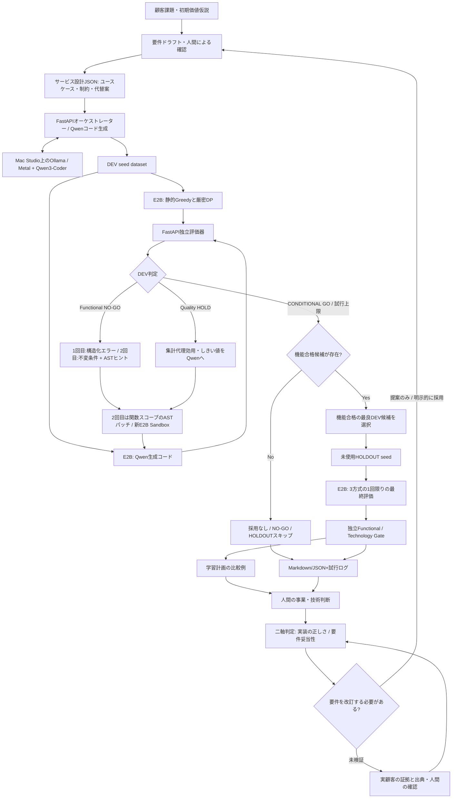

# v0.6 Architecture

## Isolation

- APIキーはFastAPIコンテナ側の環境変数のみで利用。E2B Sandboxへは生成コード・合成データだけを渡す。
- E2Bの各候補・改訂は独立したSandbox。開発用seedは同じ候補Sandboxで逐次実行し、各seedの出力ファイルを削除してから開始。
- 評価器はFastAPI側でLLMから独立。生成コード内のコメント・説明文を採否判定の根拠としない。
- DEV/HOLDOUTの境界はFastAPI側のオーケストレーションで強制。Qwenの修正コールバックが見るのはDEVのエラーと集計指標だけ。有効なDEV候補がない場合はHOLDOUTデータを生成せず、E2Bも呼び出さない。
- 静的AST診断はヒューリスティックな可能性の指摘であり、決定的な不具合の証明ではない。実際の採否は独立評価器によるテストでのみ判断。
- DEVスコアで候補を選ぶため、選択バイアスは存在する。HOLDOUTも同じ合成分布であり、実業務の性能の証拠ではない。

## External vs internal port

`compose.yaml` は `127.0.0.1:${API_PORT:-18000}:8000` を維持し、APIプロキシはDocker内`api:8000`を利用。Viteは5173番。

## Product positioning

新規事業を担当する人の初期技術検証を補佐する架空デモ。コードの安全な実行、監査可能な修正、技術選定の比較証拠を出すことが目的で、実在のSun Asterisk案件の実装物ではない。

## Requirement-level outer loop

- コードの内側ループ（機能NO-GO・品質HOLD）とは独立して、**要件の妥当性**を検証する。
- Qwenの外側ループへ渡すのはDEVの集計結果・診断と人間が提示した顧客証拠のみ。HOLDOUTを戻さない。
- 要件の`AC-01`などに紐づく顧客証拠を出典情報とともに保持。`synthetic`は要件の成立性を示す証拠に使わない。
- 要件改訂案は人間の承認待ちとし、元の要件ファイルを上書きしない。人間が受け入れたときのみ新しいrevisionとして再設計・再実験。
- データセットの最終評価はrevごとにseedを分離する。ただし反復実験で見たHOLDOUTを使って人間が要件を修正すれば、統計的には間接的な選択バイアスが残る。重要な最終主張には別途固定・完全秘匿の外部評価セットが必要。
- AIが提案したサービス設計が元の要件を充足しているという厳密な証明は**未実装**。要件と実装I/Oの固定評価は教育SaaSのみ。
